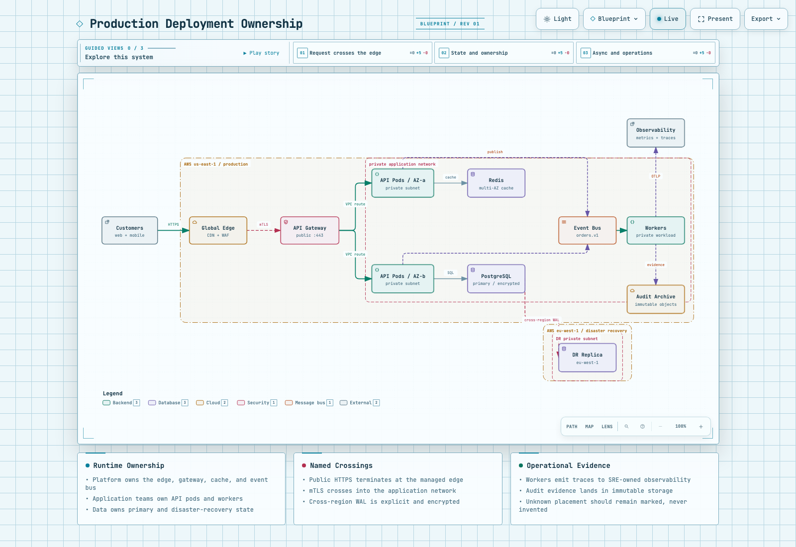
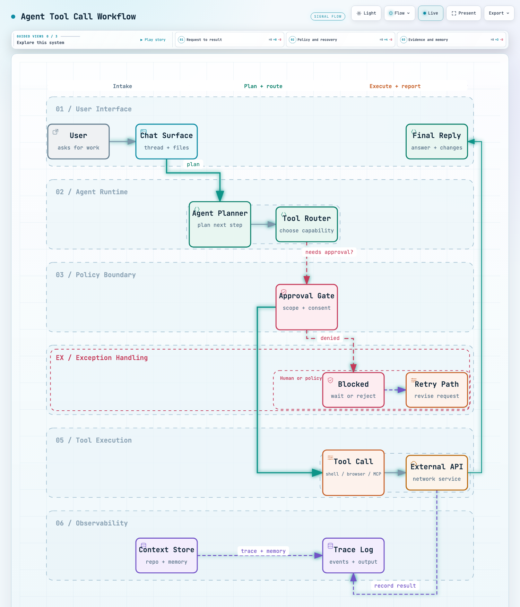

# 31K Star 的 Archify：一句话生成可交互的架构图

画架构图这件事，一直挺别扭。

用 draw.io 得手动拖框连线，改一次动半天；用 Mermaid 语法是省事了，但出来的图只能看，样式也谈不上好看。

最近发现一个叫 **Archify** 的 Agent Skill，GitHub 上已经 **31K Star**，思路和上面两条都不一样：你在对话里用大白话把系统描述一遍，它直接生成一个**可交互的 HTML 图**。

## 支持五类图

Archify 把技术图归成了五类，你描述需求，它自己判断该用哪种视觉语言：

| 类型 | 适用场景 |
|---|---|
| **Architecture** | 云基础设施、微服务拓扑、安全边界、网络布局 |
| **Workflow** | 泳道流程，含审批门禁、异步分支、可观测性通道 |
| **Sequence** | API 调用链、请求生命周期、缓存回源、鉴权与异步追踪 |
| **Data Flow** | 数据管道、ETL、埋点分析、PII 隔离、数仓同步与血缘 |
| **Lifecycle** | 状态机、对象生命周期，含等待态、重试、取消、终态 |

下面这张是官网的**架构图**示例，一眼能看出多区域、私有网络、跨区复制和审计留痕的关系：



这张是**流程图**示例，画的是 Agent 工具调用循环，泳道分了用户界面、Agent 运行时、策略边界、异常处理、工具执行和可观测性：



## 几个真正好用的点

**改图靠聊天。** "加个 Redis"、"把 auth 移到左边"、"API 用翠绿色"——直接说就行，不用学任何编辑器或 DSL。

**单文件，零依赖。** 产物是一个自包含 HTML，没有服务端、没有运行时，双击就能打开。丢进邮件附件或者 PR 评论里，对方直接能看。

**图是可以点的。** 支持 MAP → READ → FULL 三档阅读深度，能沿着标注好的路径逐跳播放，还能钉住某个节点生成稳定链接——别人打开看到的是同一个位置。

**导出很讲究。** PNG / JPEG / WebP 都是浏览器原生 4 倍分辨率渲染，不是放大插值，投屏和打印都不糊。SVG 导出内嵌了 `prefers-color-scheme` 规则，丢进 GitHub README 会自动跟随读者的深浅色主题。

**官网自己就是证据。** 官网那 11 个示例不是手写的宣传图，而是从版本化的 JSON 源数据自动生成的，每张都带 SHA-256 摘要和结构校验结果，点开就能看源码。用它自己的话说：Proof, not promises。

## 怎么装

一行命令，支持 Cursor、Claude Code、Codex、OpenCode：

```bash
npx skills add tt-a1i/archify -g
```

装完直接跟你的 Agent 说"用 Archify 画一下这个系统"就行，也可以让它先分析仓库再画。

## 地址

- GitHub：https://github.com/tt-a1i/archify
- 官网示例库：https://tt-a1i.github.io/archify/gallery.html

MIT 协议，开源免费。下次画架构图之前，值得先试一下。
